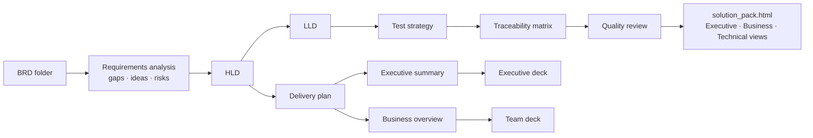

# BRD Solution Agent

An agent that reads your **Business Requirement Documents (BRDs)** from a folder and produces a
complete, audience-aware **solution pack**: requirements analysis, HLD, LLD, delivery plan, test
strategy, traceability, executive and business summaries, and slide decks. It's built on Claude
(`claude-opus-5-5`).

Each document is saved the moment its stage finishes, so you can start reading the analysis while
the design is still being written.

## Quick start

```bash
pip install -r requirements.txt
export ANTHROPIC_API_KEY=sk-ant-...        # or: ant auth login

mkdir brds && cp path/to/your/*.docx brds/  # .md .txt .pdf .docx .csv .json .yaml supported
python -m brd_agent run                     # reads ./brds, writes ./output
```

Try it with the bundled sample:

```bash
python -m brd_agent run -i examples/brds -o output
```

Then open **`output/solution_pack.html`** in a browser, or follow **`output/PROGRESS.md`** while
it runs.

## What you get

| # | File | For | What it is |
|---|---|---|---|
| 1 | `01_requirements_analysis.md` / `.json` | Everyone | Objectives, KPIs, stakeholders, scope, FR/NFR with IDs, MoSCoW priority and acceptance criteria |
| 2 | `02_gaps_questions_and_ideas.md` | Business owner | Gaps and ambiguities, **clarifying questions to send back**, **suggested enhancements the BRD missed**, risks, glossary |
| 3 | `03_high_level_design.md` | Architects, tech leads | Context and component diagrams (Mermaid), key flows, data, integration, tech stack, deployment, security, NFR design, ADRs |
| 4 | `04_low_level_design.md` | Developers | Modules, API specs, ER diagram and tables, sequence and state diagrams, business rules, errors, config, jobs, CI/CD |
| 5 | `05_delivery_plan.md` | Sponsors, PMO | MVP and phases, Gantt chart, team and RACI, effort and cost estimates with their assumptions, risk register, adoption plan |
| 6 | `06_test_strategy.md` | QA, UAT users | Test levels, test case catalogue mapped to requirements, NFR tests, UAT plan |
| 7 | `07_traceability_matrix.md` / `.csv` | PMO, QA, auditors | Requirement → HLD component → LLD element → test → phase, with coverage % |
| 8 | `08_executive_summary.md` | C-level | 5-minute read: bottom line, value, cost and timeline, risks, decisions needed |
| 9 | `09_business_overview.md` | Non-technical teams | Before/after day-in-the-life, plain-language explanation, what changes for them, FAQ |
| 10 | `10_executive_deck.html` / `.pptx` / `.md` | Steering committee | 8–10 slide deck with speaker notes |
| 11 | `11_team_deck.html` / `.pptx` / `.md` | Business and delivery teams | 12–16 slide deck, simple-to-detailed |
| 12 | `12_quality_review.md` | Design authority | An independent self-review that scores the pack and lists uncovered requirements, inconsistencies and fixes |
| – | `00_change_impact.md` | Everyone | Written when the BRDs change: what changed and how it affects design, cost, timeline and risk |
| – | `solution_pack.html` | Everyone | One portal with **Executive / Business / Technical views** and rendered diagrams |
| – | `PROGRESS.md` | You | Live stage-by-stage status |

HTML decks: use the arrow keys to move between slides, **N** to show speaker notes, and Ctrl/Cmd+P to save as PDF.
The `.pptx` files are only produced when `python-pptx` is installed.

## Features beyond the basic ask

- **Progressive output and resume.** Each stage writes its files as soon as it finishes. If a run is interrupted (Ctrl+C, network, rate limit), running it again picks up where it stopped.
- **Gap detection and clarifying questions.** The agent flags vague, missing or contradictory requirements and drafts the questions to send to the business owner.
- **Ideas you didn't ask for.** It suggests enhancements such as audit trails, observability, accessibility and DR, along with the rationale and expected effort.
- **Traceability.** Every requirement maps to design, tests and a delivery phase, and the matrix shows coverage.
- **Self-review.** An independent "design authority" pass scores the pack and lists what to fix.
- **Change impact.** When you edit a BRD, the agent archives the old pack under `output/history/<timestamp>/`, rebuilds, and explains what changed.
- **Watch mode.** Put new or updated BRDs in the folder and the pack rebuilds automatically.
- **Ask mode.** Ask questions about the BRDs and the solution, with answers tailored to executive, business or technical readers.
- **Cost-aware.** The BRDs are prompt-cached once and reused by every stage, and token usage is printed at the end.

## Commands

```bash
# Build or resume the pack
python -m brd_agent run -i brds -o output

# Rebuild only some documents (prerequisites are included automatically)
python -m brd_agent run --stages executive_summary,executive_deck

# Rebuild everything from scratch (old pack is archived in output/history/)
python -m brd_agent run --force

# Faster: run independent stages in parallel (live text streaming is off in this mode)
python -m brd_agent run --workers 3

# Cheaper and faster drafts, or deeper reasoning for complex programmes
python -m brd_agent run --effort medium
python -m brd_agent run --effort xhigh

# Rebuild automatically whenever the BRD folder changes
python -m brd_agent watch -i brds --interval 60

# Ask questions
python -m brd_agent ask "What will this cost and when do we go live?" --audience executive
python -m brd_agent ask "How do we call the core banking SOAP API?" --audience technical
python -m brd_agent ask                       # interactive Q&A session
```

Stage keys: `analysis, hld, lld, delivery, tests, executive_summary, business_overview,
traceability, executive_deck, team_deck, review`.

## How it works



- `brd_agent/ingest.py` loads the documents and fingerprints them to detect changes.
- `brd_agent/pipeline.py` defines the stage graph, handles progressive saving and resume, archives old packs, writes the change impact report, and supports parallel workers.
- `brd_agent/prompts.py` holds the instructions for each deliverable. Edit this file to match your organisation's templates.
- `brd_agent/schemas.py` defines the structured outputs (analysis, traceability, decks, review), which are validated with pydantic.
- `brd_agent/render.py` produces the Markdown, CSV, HTML decks, PPTX and the portal.
- `brd_agent/llm.py` is the Claude client. It uses adaptive thinking, streaming, prompt caching, and server-side refusal fallback (`fallbacks: "default"`).

## Notes

- Cost and effort figures are **estimates**. The delivery plan shows its assumptions so you can adjust them.
- Treat the output as a strong first draft for your architects and BAs to review, not a signed-off design.
- Scanned PDFs (images only) have no text layer. Run them through OCR first.

## Tests

```bash
pip install pytest
python -m pytest -q      # runs offline with a fake model; no API key needed
```
